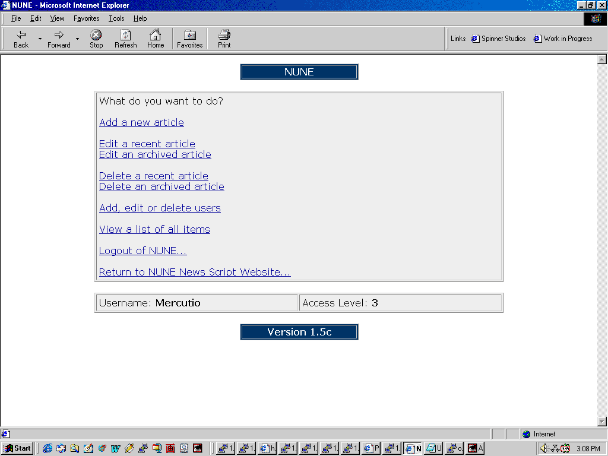

# nune

A web-based news script for PHP 4 and MySQL, written in the summer of 2000. You post, edit and archive news items through a browser, with separate logins and three access levels per user. It started as a cleanup of Mike McMurray's MyNews 1.0 and ended up as a rewrite.

## History

The original [CHANGES](CHANGES) file covers the early versions:

| Version | Date | Notes |
|---|---|---|
| 0.5 | before July 2000 | Cleanup of the MyNews 1.0 code. Never released. |
| 1.0 | before July 2000 | Archiving, unique logins, better administration. Never released. |
| 1.5, 1.5a | July 2000 | Rewritten around functions, with one config file (`nune.conf`). |
| 1.5b | 27 July 2000 | The public release in this repo, tagged `v1.5b`. GPL. |
| 1.5c | August 2000 | Only survives in the screenshots in [docs/screenshots](docs/screenshots). |
| 2 (unreleased) | October to December 2000 | Reader comments, a comment admin and page templates. |

The git history here is rebuilt from the copies that survived on banana, the FreeBSD box that hosted the sites nune ran on. Each commit is dated from its files:

1. **July 2000**: the copy installed on the NOLF Universe fan site.
2. **July 2000**: the copy installed on spinner.dhs.org.
3. **27 July 2000**: the `nune-1.5b.tar.gz` release, untouched (tag `v1.5b`).
4. **December 2000**: nune 2 as it ran on Banana III. The comments feature on the 1.5b TODO list was done by then, and `nune-lib.php` had nearly doubled in size. `nune.sql` in this commit is the live schema from the January 2001 database backup, with no data.

The sites themselves are in [cdmckay/banana](https://github.com/cdmckay/banana) and [cdmckay/spinner](https://github.com/cdmckay/spinner).

## Informium

In April 2002 I wrote a short description of a successor called Informium: "a fully featured advanced news script" in PHP 4 and MySQL, with users of differing access levels, posts and comments. A note from the same time sketches a mail module for it. Both are in [docs/informium](docs/informium). The feature list matches nune 2, so Informium looks like nune 2 under a new name. Its source didn't survive, so the December 2000 commit is the latest code there is.

## Running it

You probably shouldn't. The code depends on PHP 4 behaviour that has since been removed: `register_globals`, the `mysql_*` functions and `each()`. It also builds SQL by pasting request variables into query strings. The original [README](README) has the 2000-era install steps.

## What was changed

- The database passwords in the deployed `nune.conf` files are replaced with `REDACTED`.
- News posts, comments and user accounts from the live databases aren't included.

## Licence

GPL, version 2 (see [COPYING](COPYING)), as nune 1.5b was released.
